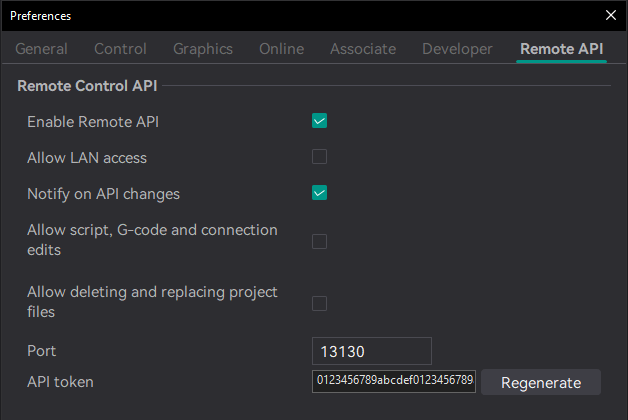

  <picture>
    <source media="(prefers-color-scheme: dark)" srcset="doc/images/readme/logo-dark.svg">
    
  </picture>

<h3 align="center">OrcaSlicer 2.5, with a way in for an AI assistant.</h3>

  
  
  

This is the **OrcaSlicer MCP build**: [OrcaSlicer](https://github.com/OrcaSlicer/OrcaSlicer) 2.5.0 with two additions. A local API lets an AI assistant, which you talk to in your usual AI app, change settings, load and slice models, and read back the result, through the [orcaslicer-mcp](https://github.com/MaxEllis/orcaslicer-mcp) server. A panel beside the 3D view lists every change it makes, with a way to undo each one. Everything else is OrcaSlicer, rebuilt from the upstream release, and it uses your existing printers and presets.

Rather keep stock OrcaSlicer? The [plugin](https://github.com/MaxEllis/orcaslicer-mcp#two-ways-to-run-it) covers settings and presets.

## Install

| Platform | File on the [latest release](https://github.com/MaxEllis/OrcaSlicer/releases/latest) |
|---|---|
| Windows 10/11 | `win64-installer.exe` (Arm: `winarm64-installer.exe`), or the portable `.zip` |
| macOS 10.15 and later | `macos-universal.dmg`. It is signed but not notarized: the first launch needs **System Settings → Privacy & Security → Open Anyway**. |
| Linux | `linux-x64.AppImage` or `linux-aarch64.AppImage`, or the `.flatpak` files |

Then open **Preferences → Remote API**, tick **Enable Remote API**, copy the token, and follow the [setup steps](https://github.com/MaxEllis/orcaslicer-mcp#get-started) to connect your assistant app.

## The panel

- **Every change, grouped** by round of work, with the print time of each slice.
- **Undo any one** with the link beside it: Revert, Rotate back, Put back. An undo never overwrites something changed since.
- **Go back to an earlier point** from an older group. It asks first, and can be undone.
- **Your own edits count.** Change something yourself and the panel shows your value; the assistant is told with its next reply.

Close it with its ✕ and bring it back from **View → OrcaSlicer MCP panel**.

 

## Safety

- **Off until you enable it**, and it listens on this computer only. **Allow LAN access** is a separate box.
- **Every request needs the token.** Regenerate it to cut off every client at once.
- **No scripts, G-code or printer connection changes** until you tick **Allow script, G-code and connection edits**, and **no deleting or replacing project files** until you tick **Allow deleting and replacing project files**.
- **Passwords and API keys** are left out of everything the API returns.

## Updates

The build checks this repository for new releases and offers them in OrcaSlicer's usual update dialog. Releases are named after the OrcaSlicer version plus this fork's number (`v2.5.0-mcp.16`), follow upstream's stable releases only, and are built by GitHub Actions with checksums in `SHA256SUMS.txt`.

## Problems and credits

Report problems on the [orcaslicer-mcp issue tracker](https://github.com/MaxEllis/orcaslicer-mcp/issues). Anything that also happens in stock OrcaSlicer belongs with [OrcaSlicer](https://github.com/OrcaSlicer/OrcaSlicer/issues). The API is documented in the [Remote API reference](docs/remote-api/README.md).

OrcaSlicer is made by the [OrcaSlicer team and contributors](https://github.com/OrcaSlicer/OrcaSlicer/graphs/contributors) and builds on Bambu Studio, PrusaSlicer and Slic3r. This fork is AGPL-3.0, like OrcaSlicer ([LICENSE.txt](LICENSE.txt)). If it saves you time, you can [buy me a coffee](https://buymeacoffee.com/maxellis).
