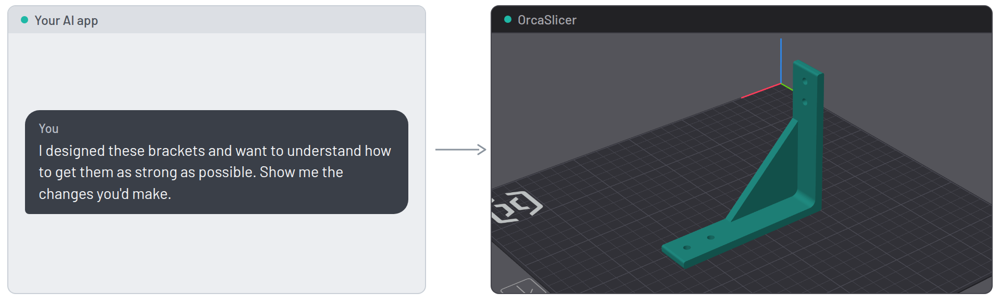
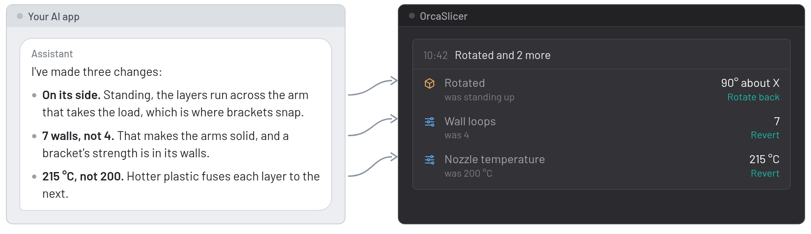
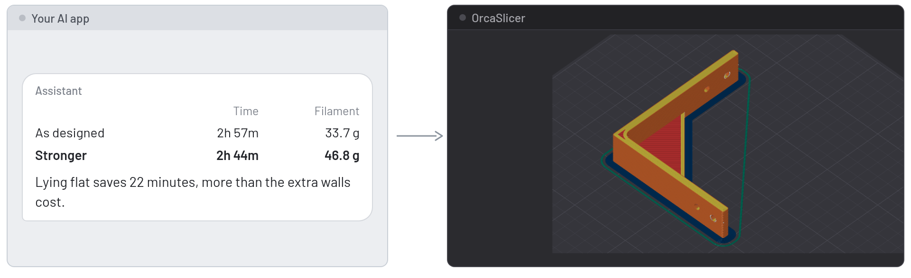

  <picture>
    <source media="(prefers-color-scheme: dark)" srcset="doc/images/readme/logo-horizontal-dark.svg">
    
  </picture>

<h3 align="center">OrcaSlicer 2.5, with a way in for an AI assistant.</h3>

  
  
  

**1. Tell it your goal**

**2. It changes what matters, and explains why**

**3. See the trade-off before you print**

This is the **OrcaSlicer MCP build**: [OrcaSlicer](https://github.com/OrcaSlicer/OrcaSlicer) 2.5.0 with two additions. A local API lets an AI assistant, which you talk to in your usual AI app, change settings, load and slice models, and read back the result, through the [orcaslicer-mcp](https://github.com/MaxEllis/orcaslicer-mcp) server. The OrcaSlicer MCP panel beside the 3D view lists every change it makes, with a way to undo each one. Everything else is OrcaSlicer, rebuilt from the upstream release, and it uses your existing printers and presets.

Rather keep stock OrcaSlicer? The [plugin](https://github.com/MaxEllis/orcaslicer-mcp#orcaslicer-mcp-build-or-plugin) covers settings and presets.

## Install

| Platform | File on the [latest release](https://github.com/MaxEllis/OrcaSlicer/releases/latest) |
|---|---|
| Windows 10/11 | `win64-installer.exe` (Arm: `winarm64-installer.exe`), or the portable `.zip` |
| macOS 11 and later, Apple silicon | `macos-arm64.dmg`. It is signed but not notarized: the first launch needs **System Settings → Privacy & Security → Open Anyway**. Intel Macs: [v2.4.2-mcp.15](https://github.com/MaxEllis/OrcaSlicer/releases/tag/v2.4.2-mcp.15) has a universal build. |
| Linux | `linux-x64.AppImage` or `linux-aarch64.AppImage`, or the `.flatpak` files |

The installer and the Mac app take the place of OrcaSlicer: same name, same place, same profile folder, so your printers and presets carry over. To keep stock OrcaSlicer as well, use the portable Windows zip or the Linux AppImage.

Then open **Preferences → Remote API**, tick **Enable Remote API**, copy the token, and follow the [setup steps](https://github.com/MaxEllis/orcaslicer-mcp#get-started) to connect your assistant app.

## The OrcaSlicer MCP panel

- **Every change, grouped** by round of work, with the slice result.
- **Undo any one change.** Each shows its old value and an undo named for what it does: Revert, Switch back, Rotate back, Remove, Put back.
- **Restore to here** on an older group puts the whole project back to that point. A restore can be undone too.
- **Your own edits count.** If you change a setting the assistant changed, its row says "changed by you". The assistant is told about every setting you change by hand, with its next reply.
- **Kept with the project,** so the timeline is still there after a restart.

OrcaSlicer's own Ctrl+Z (⌘Z on a Mac) undoes model edits, not settings, so take a setting back from the panel. While the panel is open, OrcaSlicer's change notifications stay hidden; refusals still show. The gear opens **Preferences → Remote API**. Close the panel with its ✕ and bring it back from **View → OrcaSlicer MCP panel**; the note that appears when you close it says so, and its Undo opens the panel again.

 

## Safety

- **Off until you enable it**, and it listens on this computer only. **Allow LAN access** is a separate box.
- **Every request needs the token.** Regenerate it to cut off every client at once.
- **No scripts, G-code or printer connection changes** until you tick **Allow script, G-code and connection edits** in **Preferences → Remote API**. Only that box allows them, and no assistant or API call can tick it.
- **No deleting or replacing project files** until you tick **Allow deleting and replacing project files**.
- **Passwords and API keys** are left out of everything the API returns.

## Updates

The build checks this repository for new releases and offers them in OrcaSlicer's usual update dialog. Releases are named after the OrcaSlicer version plus this fork's number (`v2.5.0-mcp.16`), follow upstream's stable releases only, and are built by GitHub Actions with checksums in `SHA256SUMS.txt`.

## Problems and credits

Report problems on the [orcaslicer-mcp issue tracker](https://github.com/MaxEllis/orcaslicer-mcp/issues), which covers this build, the plugin and the connector, so nothing gets lost between them. Anything that also happens in stock OrcaSlicer belongs with [OrcaSlicer](https://github.com/OrcaSlicer/OrcaSlicer/issues). The API is documented in the [Remote API reference](docs/remote-api/README.md).

OrcaSlicer is made by the [OrcaSlicer team and contributors](https://github.com/OrcaSlicer/OrcaSlicer/graphs/contributors) and builds on Bambu Studio, PrusaSlicer and Slic3r. This fork is AGPL-3.0, like OrcaSlicer ([LICENSE.txt](LICENSE.txt)). If it saves you time, you can [buy me a coffee](https://buymeacoffee.com/maxellis).
